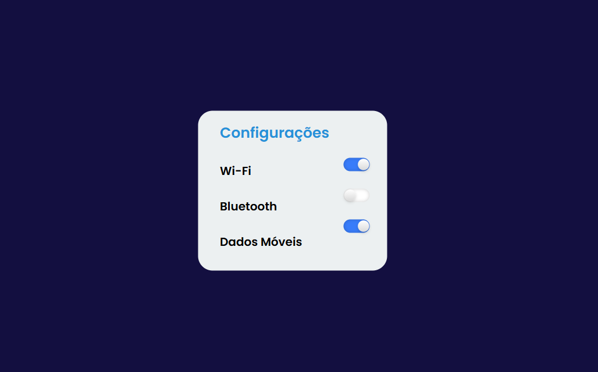

# ⚙️ Caixa de Seleção Personalizada

Projeto de um painel de configurações com botões de alternância personalizados, desenvolvido com **HTML5 e CSS3** como parte de uma atividade prática do curso PROA.

O projeto tem como objetivo explorar conceitos de personalização de elementos de formulário, estilização de caixas de seleção e criação de efeitos interativos utilizando CSS, simulando controles de ativação e desativação de configurações.

## 🖥️ Prévia do projeto

  

🔗 **[Acesse o projeto online](https://gabrielc0liveira.github.io/Projeto12Proa-CaixadeSelecaoPersonalizada/)**

## Funcionalidades e características

- Painel de configurações com opções de Wi-Fi, Bluetooth e Dados Móveis.
- Botões de alternância personalizados para ativar e desativar opções visualmente.
- Mudança de cor dos interruptores conforme o estado selecionado.
- Animação suave de deslocamento dos botões.
- Personalização visual de elementos `checkbox` utilizando CSS.
- Efeitos de profundidade com sombras e gradientes.
- Layout centralizado com bordas arredondadas.
- Interatividade desenvolvida inteiramente com HTML e CSS, sem JavaScript.

## Tecnologias utilizadas

- **HTML5:** estruturação do painel de configurações e dos elementos de seleção.
- **CSS3:** estilização, posicionamento, animações e personalização dos interruptores.
- **Google Fonts:** utilização da fonte Poppins.

## Aprendizados

Durante o desenvolvimento, foram praticados conceitos como:

- Estruturação de elementos de formulário utilizando `input type="checkbox"`.
- Personalização de componentes nativos com `appearance: none`.
- Utilização da pseudoclasse `:checked` para identificar opções selecionadas.
- Criação de elementos visuais utilizando o pseudoelemento `::before`.
- Desenvolvimento de animações suaves com `transition`.
- Aplicação de gradientes e sombras para criar efeitos de profundidade.
- Posicionamento e centralização de elementos com CSS.
- Criação de componentes interativos sem a necessidade de JavaScript.

## 📂 Como executar o projeto

🔗 **[Acesse o projeto online](https://gabrielc0liveira.github.io/Projeto12Proa-CaixadeSelecaoPersonalizada/)**

---

Desenvolvido por **Gabriel Oliveira** como parte das atividades práticas do PROA.
